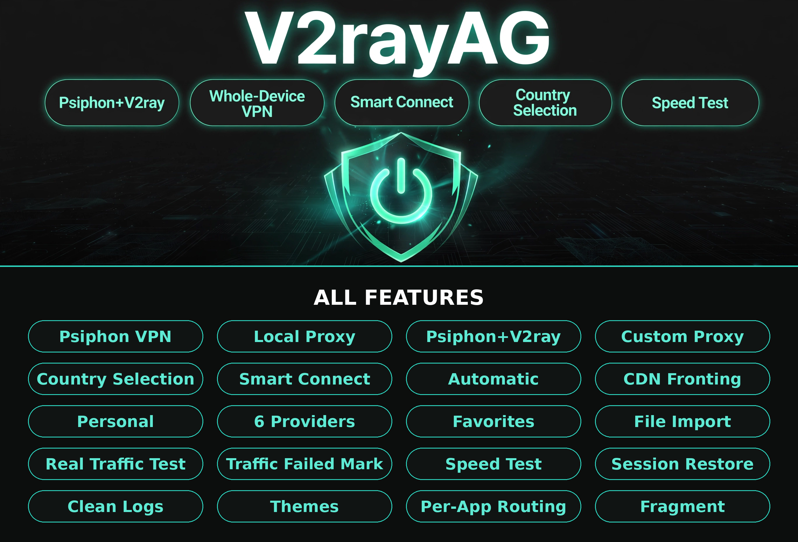

# V2rayAG

[](https://github.com/alireza-spec/V2rayAGVpn/actions/workflows/build-apk)
[](https://github.com/alireza-spec/V2rayAGVpn/releases/latest)

اپ اندرویدی V2rayAG؛ ساخته‌شده با Flutter. این نسخه‌ی **v1.0.0**، اولین نسخه‌ی رسمی
است و **هیچ قابلیتی در آن کم نشده است** — ساختار پروژه هم یک پروژه‌ی واقعی Flutter
با فایل و فولدر است، نه تک‌فایل بیلد.

> پکیج اپ همان `com.v2rayag.v2rayag` است، پس نسخه‌ی جدید روی نصب قبلی هم به‌روزرسانی می‌شود.

## نصب

از صفحه‌ی [آخرین ریلیز](https://github.com/alireza-spec/V2rayAGVpn/releases/latest) یکی را بگیرید:

- **V2rayAG-arm64-v8a.apk** — بیشتر گوشی‌های ساخته‌شده بعد از ۲۰۱۷
- **V2rayAG-armeabi-v7a.apk** — گوشی‌های قدیمی‌تر ۳۲ بیتی
- **V2rayAG-universal.apk** — روی همه‌ی گوشی‌ها کار می‌کند، حجمش بیشتر است

## قابلیت‌ها

### اتصال

- **Psiphon VPN** — سایفون سراسری برای کل گوشی (Whole-Device)
- **Local Proxy** — پروکسی محلی روی گوشی
- **Psiphon+V2ray** — اتصال ترکیبی: اول تونل سایفون، بعد کانفیگ V2ray از داخل آن
- **Custom Proxy** — پروکسی دستی؛ آی‌پی و پورت SOCKS سالم را خودتان وارد می‌کنید
- **Country Selection** — انتخاب کشور خروجی سایفون (۱۹ کشور)

### حالت‌ها

- **Smart Connect** — پروایدرها، بعد CDN، بعد سایفون؛ هر مرحله فقط با ترافیک واقعی قبول می‌شود
- **Automatic** — انتخاب خودکار بهترین کانفیگ
- **CDN Fronting** — فرانتینگ CDN
- **Personal** — کانفیگ‌های شخصی خودتان

### سرورها و پروایدرها

- **۶ پروایدر** (مدیریت همه‌شان با سکرت، بدون تغییر کد — [جدول سکرت‌ها](#سکرتها))
- **Favorites** — علاقه‌مندی‌های ماندگار
- **File Import** — ایمپورت کانفیگ از فایل
- **Real Traffic Test** — تست واقعی ترافیک، نه فقط پینگ
- **Traffic Failed Mark** — کانفیگی که ترافیک واقعی ندهد، قرمز و ته لیست می‌رود

### تجربه

- **Speed Test** — تست سرعت با گیج زنده
- **Session Restore** — باز شدن دوباره‌ی اپ در حالی که هنوز متصل است
- **Clean Logs** — لاگ‌های تمیز، بدون اسپم
- **Themes** — چند تم و رنگ
- **Per-App Routing** — مسیریابی هر اپ
- **Fragment** — فرگمنت برای دور زدن محدودیت‌ها

## ساختار پروژه

```text
lib/
  main.dart            نقطه‌ی شروع اپ
  app/store.dart       وضعیت مرکزی اپ (Store) و ترجمه‌ها
  engine/              موتورها: سایفون، هسته‌ی V2ray، پروایدرها، استخر،
                       فرانتینگ، اسکنر، تست سرعت، پروب TCP
  ui/                  صفحه‌ها و صفحه‌ی تست سرعت
android/               کد اندروید: MainActivity و پل سایفون (PsiphonBridge)
assets/                آیکون اپ
test/                  تست موتور استخر
.github/workflows/     ورک‌فلوی بیلد و ریلیز خودکار APK
```

## سکرت‌ها

همه‌ی پروایدرها و داده‌های حساس فقط از طریق **سکرت‌های ریپو** خوانده می‌شوند؛ هیچ‌کدام
داخل کد یا فایل بیلد نیستند. برای اضافه کردن، در گیت‌هاب به مسیر زیر بروید:

**Settings → Secrets and variables → Actions → New repository secret**

مقدارها را **خام** وارد کنید (نه base64)؛ ورک‌فلو موقع بیلد خودش base64شان می‌کند.
سکرت‌ها فقط موقع بیلد خوانده می‌شوند، پس بعد از هر تغییر سکرت باید یک بیلد تازه بگیرید
(از تب Actions روی **build-apk** گزینه‌ی **Run workflow**).

| سکرت | چیست | اگر خالی باشد |
|---|---|---|
| `PROVIDERS_JSON` | لیست پروایدرها؛ آرایه‌ی JSON با `id` و `name` و `enabled` و `hours` و `sources` | لیست داخلی پیش‌فرض استفاده می‌شود |
| `PROVIDER_FAST` | یک پروایدر؛ یک آبجکت JSON تکی | همان پروایدر از لیست داخلی/عمومی می‌آید |
| `PROVIDER_UPDATE` | یک پروایدر؛ یک آبجکت JSON تکی | مثل بالا |
| `PROVIDER_V2RAYAG` | یک پروایدر؛ یک آبجکت JSON تکی | مثل بالا |
| `PROVIDER_ANTIFILTER` | یک پروایدر؛ یک آبجکت JSON تکی | مثل بالا |
| `PROVIDER_HIDDIFY` | یک پروایدر؛ یک آبجکت JSON تکی | مثل بالا |
| `PROVIDER_UNLIMITED` | یک پروایدر؛ یک آبجکت JSON تکی | مثل بالا |
| `PSIPHON_JSON` | بوت‌استرپ کامل سایفون برای جایگزینی نمونه‌ی داخلی | نمونه‌ی عمومی داخلی استفاده می‌شود |
| `UNLIMITED_CONFIGS` | کانفیگ‌های داخلی Unlimited؛ هر خط یک لینک کانفیگ | پروایدر Unlimited کانفیگ داخلی ندارد |
| `POOL_LIST` | آدرس‌های سابسکریپشن استخر، با کاما جدا شده | استخر خالی می‌ماند |
| `POOL_URL` | یک آدرس سابسکریپشن برای استخر | استخر خالی می‌ماند |

## ساخت محلی

```sh
flutter pub get
flutter test
flutter build apk --release --split-per-abi
```

خروجی‌ها در `build/app/outputs/flutter-apk/` ساخته می‌شوند. برای بیلد با سکرت‌ها، همان
`--dart-define`های ورک‌فلوی `.github/workflows/build.yml` را بدهید.

## بیلد و ریلیز خودکار

هر پوش به شاخه‌ی `main` (یا اجرای دستی از تب Actions) ورک‌فلوی **build-apk** را اجرا می‌کند:
تست‌ها، بیلد سه APK، و انتشار ریلیز با تگ نسخه‌ی `pubspec.yaml` (مثلاً `v1.0.0`)
به‌عنوان Latest (فقط فایل‌های `.apk`، بدون zip). برای نسخه‌ی بعدی کافی است همان یک خط
`version` در `pubspec.yaml` عوض شود. عدد بیلد داخل اپ هم از روی همان نسخه ساخته
می‌شود (v1.0.0 → 100) تا بررسی آپدیت درست کار کند.
